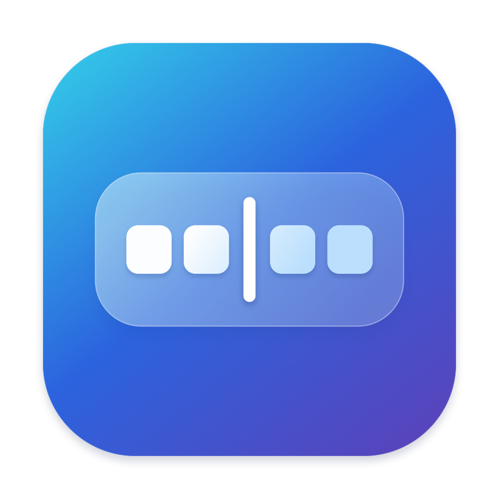

<p align="center">
  
</p>
<h1 align="center">DockDivider</h1>
<p align="center">A little breathing room for your Mac’s Dock.</p>

DockDivider helps you group your apps with subtle lines and empty spaces. Pick a style, add it where you want it, and preview the result before applying it to your Dock.

## Features

- Five styles: System, Thin Divider, Standard Divider, Spacer and Small Spacer.
- Move your dividers with drag and drop or the arrow buttons.
- Transparent divider backgrounds and automatic Light/Dark Mode matching.
- Automatic backups, with options to restore your previous Dock or remove all your dividers.
- A native macOS interface with instant switching between English, German and your system language.

The preview shows apps pinned with **Keep in Dock**. Apps that are only running and disappear when closed aren’t included. Line dividers use transparent helper icons; spacers use the Dock’s built-in gaps.

## Screenshots

**The app**


**In the Dock**


<!-- Replace the placeholders with Documentation/Screenshots/app.png and Documentation/Screenshots/dock.png when ready. -->

## Build and run

Requires macOS 14 or later and Xcode or Apple Command Line Tools with Swift 6 and a macOS SDK.

```sh
./scripts/build.sh release
open build/DockDivider.app
```

Want to try it first? Launch a demo that leaves your Dock untouched:

```sh
open -n build/DockDivider.app --args --demo
```
